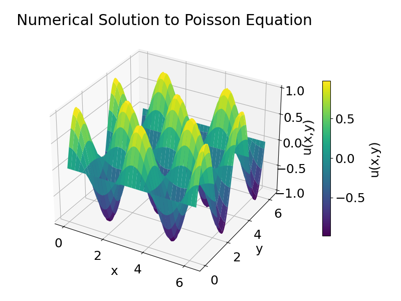

# HW 2: Working with Immersed Boundaries

## Problem 1: Poisson Equation

To find $f$ we can take the second derivative of $u(x, y)$ with respect to x and y. 

$$\frac{\partial^2 u}{\partial x^2} = -4\cos{(2x)}\sin{(2y)} \qquad \qquad \frac{\partial^2 u}{\partial y^2} = -4\cos{(2x)}\sin{(2y)}$$

Thus 

$$f = -8\cos{(2x)}\sin{(2y)}$$

When we use the finite difference method to solve the Poisson equation we get 

|  |
| :-: |
| *Figure 1: Numerical Solution to Poisson Equation for $u(x,y) = sin(2y)cos(2y)$* |

## Problem 2: Poisson Equation with an Immersed Boundary

## Problem 3: An almost minimal surface

## Problem 4: Charlie's rule