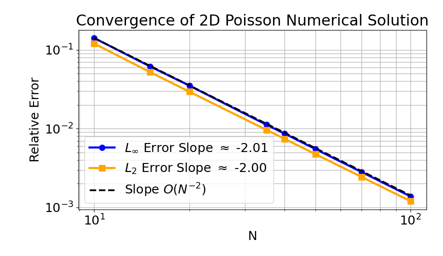
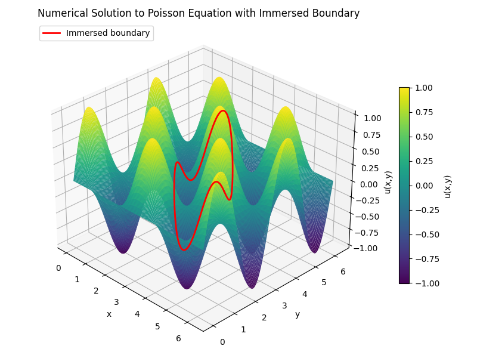
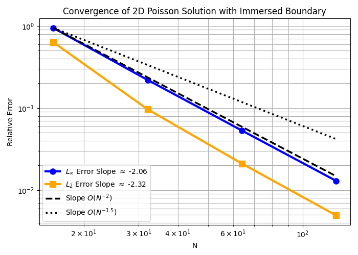
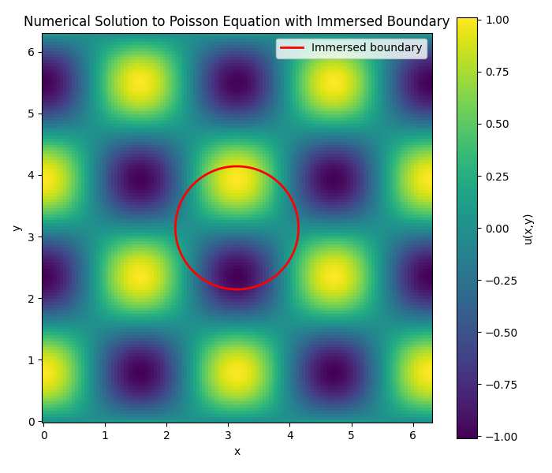
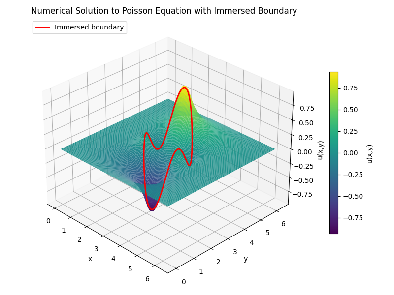
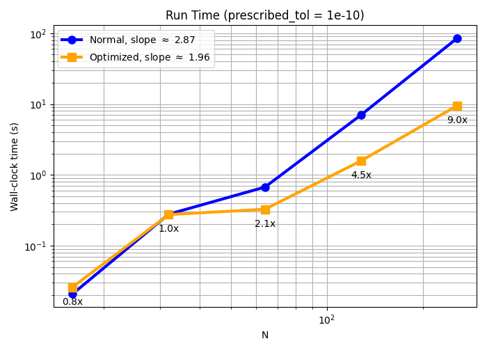
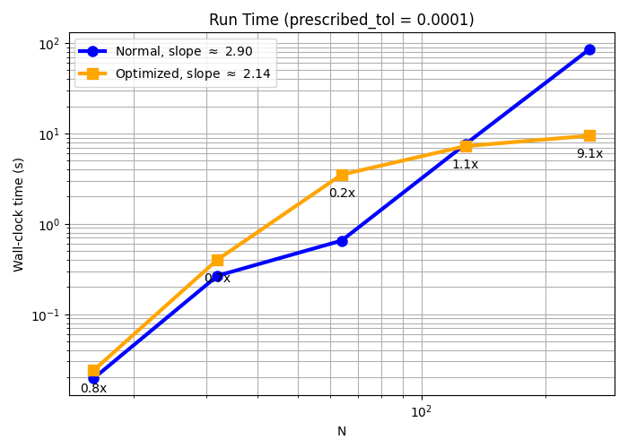

# HW 2: Working with Immersed Boundaries

## Problem 1: Poisson Equation

We solve $\nabla^2 u = f(x,y)$ on $[0, 2\pi] \times [0, 2\pi]$ with Dirichlet boundary conditions, choosing $f$ and the boundary conditions so that the test solution is 

$$u(x, y) = \cos (2x) \sin (2y).$$

Differentiating the test solution twice in each direction gives

$$\frac{\partial^2 u}{\partial x^2} = -4\cos{(2x)}\sin{(2y)} \qquad \qquad \frac{\partial^2 u}{\partial y^2} = -4\cos{(2x)}\sin{(2y)}$$

so

$$f(x, y) = \nabla^2 u = -8\cos{(2x)}\sin{(2y)}.$$

Evaluating the test solution on each edge of the box gives

$$u(0, y) = u(2\pi, y) = \sin(2y), \qquad u(x, 0) = u(x, 2\pi) = 0.$$

### Results

|  |
| :-: |
| *Figure 1: Numerical Solution to Poisson Equation for $u(x,y) = \cos(2x)\sin(2y)$* |

Figure 2 shows that both errors decrease with fitted slopes of approximately $-2$ confirminh second-order convergence in $\Delta x$.

|  |
| :-: |
| *Figure 2: Relative error of the 2D Poisson solution with Dirichlet boundary conditions versus N.* |

## Problem 2: Poisson Equation with an Immersed Boundary

We placed an unknown charge $q_k$ at each of $N_{ib}$ immersed boundary points on the circle (spaced $\approx \Delta x$ apart) and spread them onto the grid with a Gaussian kernel $\delta_a$ of width $\sigma = 1.2 \Delta x$, giving $\nabla^2 u = f + S(q)$. The charges are determined by requiring that $u$, interpolated back to the IB points with the same kernel, equals $\cos(2x^{ib})\sin(2y^{ib})$; the resulting saddle-point system for $\begin{bmatrix} u(x,y) \\ q \end{bmatrix}$ is solved matrix-free with GMRES.

### Results 

|  |
| :-: |
| *Figure 3: Numerical Solution to Poisson Equation for $u(x,y) = \cos(2x)\sin(2y)$ with Immersed Boundary.* |

|  |
| :-: |
| *Figure 4: Convergence of the Poisson solution with an immersed boundary. Relative $L_{\infty}$ and $L_2$ errors against N, with $\mathcal{O}(N^{-2})$ and $\mathcal{O}(N^{-1.5})$ reference slopes.* |

|  |
| :-: |
| Figure 5: Top view of the numerical solution $u(x,y) = \lambda^2 u = -8\cos{2x}\sin{2y}$ with the immersed boundary (red circle radius 1 centered at $(\pi, \pi)$), on a 128x128 grid. The solution matches the test solution. |

As expected, Figures 3 and 5 look identical to the test solution.

**Once your code works, experiment with this spacing. What happens when the IB points are very far apart compared to the finite difference mesh size? What happens when they are very close together? Look at both the accuracy (Problem 3 will give a better idea of this) and the speed of your code?**

We control the spacing through $\alpha$, where the distance between neighboring immersed boundary points is $\Delta s \approx \alpha \Delta x$ (so $N_{ib} = \frac{2 \pi}{\alpha \Delta x^2}$ ). I ran $\alpha \in \{0.25, 0.5, 1, 2, 4, 8\}$ at $N = 64$ for both Problems 2 and 3, and recorded run time, and accuracy. Since Problem 3 has no exact solution, we can measure accuracy by we interpolate $u$ with $\mathcal{J}$ at 400 points evenly soaced around the circle (not only the IB points) and report the maximum difference from $\cos (2x) \sin (2y)$.

For Problem 2

| $\alpha$ | Max error vs. exact | Time (s) |
| --- | --- | --- |
| 0.25 | 5.33e-02 | 2.0540 |
| 0.5 | 5.33e-02 | 1.1108 |
| 1 | 5.33e-02 | 0.6534 |
| 2 | 5.33e-02 | 0.4132 |
| 4 | 5.41e-02 | 0.2443 |
| 8 | 5.76e-02 | 0.1207 |

For Problem 3

| $\alpha$ | Max mismatch on circle | Time (s) |
| --- | --- | --- |
| 0.25 | 8.26e-10 | 12.50 |
| 0.5 | 1.42e-09 | 7.58 |
| 1 | 1.40e-09 | 5.11 |
| 2 | 9.62e-07 | 1.12 |
| 4 | 1.22e-02 | 0.27 |
| 8 | 2.50e-01 | 0.15 |

**IB points far apart ($\alpha > 1$):** When the IB points are very far apart compared to the finite difference mesh size the Gaussian around the neighboring points don't overlap. The condition $u = \cos (2x) \sin(2y)$ is enforced near each immersed boundary point, but in the gaps nothing holds $u$ in place in the gaps, so it leaks through. Rather than acting like a wire the circle behaves like a few separate points. Additionally, since there are fewer points the spreading operator and interpolation operator $\mathcal{J}$ must do fewer iterations and thus are less expensive. Thus, when the IB points are very far apart compared to the finite difference mesh size then the solution is inaccurate and runs fast. 

**IB points close together ($\alpha < 1$):** When the IB points are very close compared to the finite difference mesh size then there could be multiple points per grid cell (e.g. with alpha = 0.25 and N = 64 then there is about 4 points per grid cell) which makes the neighboring Gaussians almost identical, so the extra points add no new information and thus the accuracy of the solution does not improve. The spreading operator and interpolation operator $\mathcal{J}$ iterate through all points and since there are more points this means the solver will take longer to run. 

**What should 'tol' be?**

The GMRES tolerance must be well below the discretization error ($\approx 10^{-2}$ here) so that solver error does not affect the convergence. I used relative tolerance $10^{-10}$ with restart = 1000. 

## Problem 3: An almost minimal surface

### Setup

Problem 3 reuses the Problem 2 code with $f = 0$ and homogeneous Dirichlet data on the box. The only change is in the right-hand side, the top block is now zero, so the circle data in the bottom block is the only thing driving the solution. Unlike Problem 2, there is no exact solution to compare against.

### Results

|  |
| :-: |
| *Figure 6: Solution to Problem 3 on 128 x 128 grid, with $u=0$ on the boundaries of the box and $u = \cos{(2x)}\sin{(2y)}$ prescribed on the immersed boundary boundary  (red curve: circle of radius 1 centered at $(\pi, \pi)$ ). The surface is flat away from the circle and is pulled up and down to match the boundary data along it, forming an "almost minimal surface."* |

Along the circle, the boundary data has two peaks and two dips reaching about $\pm 1$. Away from the circle, $u$ decays smoothly to zero at the walls, so the solution resembles a soap film stretched across a bent wire frame. Across the circle the slope of the surface changes abruptly. This is produced by the IB charges $q$ which here are large and change sign around the circle, unlike in Problem 2 where they were nearly zero.

## Problem 4: Charlie's rule

For Charlie's rule, I I sped up the spreading operator $\mathcal{S}$ and interpolation operator $J$, which were the bottleneck of the solver. In the original code, every IB point evaluates the Gaussian $\delta_a$ at every grid point, so each application costs $O(N^3)$ even though $\delta_a$ is essentially zero more than a few grid cells from its center. 

Since $\delta_a$ is a Gaussian with width $\sigma = 1.2 \Delta x$, we can compute the radius that only falls into our prescribed tolerance. 

### Results

**Prescribed tolerance being $1e-10$**

| $N$ | Normal Time (s) | Optimized Time (s) | Speed-up | max|U_opt - U_normal| |
| --- | --- | --- | --- | --- |
| 16 | 0.0207 | 0.0259 | 0.8 | 2.32e-09 |
| 32 | 0.2783 | 0.2748 | 1.0 | 2.05e-08 |
| 64 | 0.6711 | 0.3264 | 2.1 | 9.74e-11 |
| 128 | 7.0357 | 1.5793 | 4.5 | 1.78e-11 |
| 256 | 85.5682 | 9.5213 | 9.0 | 3.23e-13 |

|  |
| :-: |
| *Figure 7: Run time of the full solve against $N$ for the normal and optimized operators with prescribed tolerance $10^{-10}$, with fitted slopes and the speed-up labeled at each point.* |

For prescribed toleracne of $1e-4$

| $N$ | Normal Time (s) | Optimized Time (s) | Speed-up | max|U_opt - U_normal| |
| --- | --- | --- | --- | --- |
| 16 | 0.0195 | 0.0239 | 0.8 | 8.39e-04 |
| 32 | 0.2668 | 0.4024 | 0.7 | 4.06e-04 |
| 64 | 0.6523 | 3.4965 | 0.2 | 1.17e-04 |
| 128 | 7.6386 | 7.2382 | 1.1 | 1.38e-06 |
| 256 | 85.7533 | 9.4325 | 9.1 | 1.43e-07 |

|  |
| :-: |
| *Figure 8: Run time of the full solve against $N$ for the normal and optimized operators with prescribed tolerance $10^{-4}$. The optimized solver is slower than the normal one for $N = 32 - 64$ because GMRES fails to converge within its iteration limit.* |

With tolerance $10^{-10}$, the optimized solver gives the same solution as the original and its speed-up grows with $N$. On a grid with less points there is no gain, the window is fixed number of grid points, so on a small grid it coverees most of the domain and only adds overhead. As $N$ grows, the window stays the same size while the grid grows, so the savings grow like $N^2$. The full-solve speed-up is smaller than the speed-up of $\mathcal{S}$ and $J$ alone because the Laplacian and GMRES's own vector operations are unchanged. 

Loosening the tolerance to $10^{-4}$ does not help. The window only shrinks a small amount while cutting off the Gaussian at a value as large as $10^{-4}$ introduces a small jump at the window edge and causes GMRES to run until its iteration limit. This makes the optimized solver slower than the original for $N = 32$ and $N = 64$. The cost of a loose tolerance is solver reliability.